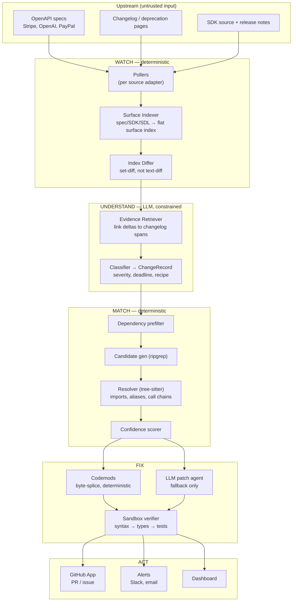

# Driftwatch — System Design

> Working name. "Dependabot for API changes": detect upstream API drift, find the code it
> breaks, and ship a verified patch.

Status: design for review. No code written yet. Source facts in Appendix A were verified
live on 2026-10-10; everything else is design intent.

Deferred production integrations and their fillable interfaces are tracked in
[productionContracts.md](./productionContracts.md). The initial deployment target is fake
GCP/gcloud for local development and CI; real cloud services are opt-in.

---

## 1. Problem, framed precisely

Dependabot answers *"is there a newer version of this library?"* It cannot answer the
question that actually causes incidents:

> *"Upstream changed their API. Does my code care, and what exactly do I change?"*

Three distinct failure modes, which matter because they need different machinery:

| Class | Example | How teams find out today |
| --- | --- | --- |
| **Hard break** | endpoint removed, required param added | 4xx/5xx in production |
| **Silent behavioral change** | a default changed, enum gained a value, rounding changed | wrong data, discovered weeks later |
| **Deadline** | "`gpt-4-vision-preview` shuts down on DATE" | an email nobody routed to the right team |

The silent class is the most valuable and the least served. Nothing on the market tells you
*"Stripe changed a default that your `charges.create` call relies on."* It is also the class
where a diff of the machine-readable spec beats reading a changelog, because the changelog
frequently does not mention it.

**Non-goals for v1:** library version bumps (Dependabot does this), runtime traffic
inspection, non-REST/GraphQL protocols (gRPC, SOAP), languages beyond Python and TypeScript.

---

## 2. The two findings that shape this design

I verified the upstream data situation before designing around it. Two results are
load-bearing (details and commands in Appendix A).

### 2.1 Provider SDKs are generated from the spec, so the endpoint→code map is derivable

The hardest part of this product is the join between *"the spec says `POST /v1/charges`
changed"* and *"your code calls `client.charges.create(...)`"*. I assumed this mapping
would need hand-curation per API per language — a brutal, unscalable bottleneck.

It does not. `stripe-python` and `stripe-node` sources both carry the header
`# File generated from our OpenAPI spec`, and the generated code contains the HTTP path as a
string literal right next to the method:

```python
# stripe/_charge_service.py
class ChargeService(StripeService):
    def create(self, params, options=None):
        return cast(Charge, self._request("post", "/v1/charges", ...))
```

Field-level params are also statically available as generated `TypedDict`s
(`ChargeCreateParams.amount`, `.currency`, ...) in Python and `ChargeListParams` interfaces
in TypeScript.

**Consequence:** the Surface Map (§5) is *built by parsing SDK source with tree-sitter*, not
written by hand. Adding a new API becomes mostly mechanical, which is exactly the moat we
want (breadth, fast).

### 2.2 For providers with no spec, the SDK source *is* the ground truth

Razorpay publishes no OpenAPI document — `api.razorpay.com/v1/openapi.json` and
`razorpay.com/docs/api/openapi.json` both 404, and the `razorpay` GitHub org has no spec
repo. But `razorpay/razorpay-python` is actively maintained.

So the watcher cannot be "an OpenAPI differ". It has to be a **pluggable source adapter**
layer where several adapter kinds produce the *same* normalized output, and SDK-source
diffing is a first-class signal, not a fallback hack. This is what lets Driftwatch cover the
long tail of APIs that never ship a spec — which is most of them.

---

## 3. Architecture



### 3.1 The central architectural rule

> **Detection is deterministic. The LLM only narrates and proposes.**

The LLM is never asked *"did something change?"* — that is computed by set-diffing surface
indexes. It is asked only to classify severity, extract deadlines, write the human
explanation, and emit a *structured* migration recipe. Every `ChangeRecord` must cite at
least one piece of evidence (a spec snapshot location or a document text span) or it is
quarantined for human review rather than shipped.

This is the difference between a product and a demo. An LLM asked to find API changes will
confidently invent them, and one hallucinated breaking change in a customer's inbox costs
more trust than ten correct ones earn.

### 3.2 Services

| Service | Responsibility | Scale shape |
| --- | --- | --- |
| `api` (FastAPI) | REST API, dashboard BFF, GitHub webhook receiver | stateless, HPA |
| `scheduler` | emits poll/scan jobs on cron, owns the daily DAG | singleton w/ leader lock |
| `worker-watch` | poll, index, diff, understand | low volume, bursty |
| `worker-match` | clone, scan, score | CPU-bound, the fan-out tier |
| `worker-fix` | codemod, LLM patch, publish | moderate |
| `sandbox-runner` | runs untrusted repo tests | isolated node pool, no cluster creds |
| Postgres | system of record | primary + replica |
| Redis | queue (arq), locks, rate-limit buckets | single |
| S3/MinIO | spec snapshots, diffs, patches, test logs | — |

`sandbox-runner` is a separate node pool with no access to the database, no cloud IAM role,
and no network egress during test execution. It executes arbitrary customer code; it must be
treated as already compromised.

---

## 4. Watch layer

### 4.1 Source adapters

```python
class SourceAdapter(Protocol):
    kind: Literal["openapi", "graphql_sdl", "sdk_source", "changelog_html",
                  "changelog_rss", "deprecation_table"]
    def poll(self, state: SourceState) -> PollResult: ...
    def index(self, raw: bytes) -> SurfaceIndex: ...   # only for ground-truth kinds
```

Per-provider configuration, reflecting what each one actually publishes:

| Provider | Ground truth | Narrative | Notes |
| --- | --- | --- | --- |
| Stripe | `openapi` — `stripe/openapi:latest/openapi.spec3.json` (unified v1/v2) | `docs.stripe.com/changelog` (200 OK) | Use the GA file under `latest/`; exclude `preview/` and SDK-only variants. The legacy `openapi/spec3.json` remains v1-only and is valid when v2 coverage is not required. |
| OpenAI | `openapi` — `openai/openai-openapi:openapi.json` + `sdk_source` for the `ChatModel` literal union | `platform.openai.com/docs/changelog`, deprecations page | Model shutdowns are the dominant change class, not endpoint changes. |
| PayPal | `openapi` — `paypal/paypal-rest-api-specifications` + `sdk_source` — `paypal/PayPal-Python-Server-SDK` | PayPal Developer REST documentation | First-class hackathon provider. Uses `paypal-server-sdk` and the generated `paypalserversdk` controllers; start with Orders v2 and Payments v2. |
| Razorpay | `sdk_source` — `razorpay/razorpay-python` | `razorpay.com/docs/api/changelog` (200 OK) | No OpenAPI exists. HTML extraction needs canary assertions (§4.5). |
| Twilio | `openapi` — `twilio/twilio-oai:spec/json/*.json` (60 files) | changelog | Post-MVP. Per-product specs → 60 sources, one provider. |
| Shopify | `graphql_sdl` | quarterly versions, 12-month deprecation window | Post-MVP. Needs the SDL differ. |

### 4.2 Polling: cheap enough to be near-real-time

A naive design polls daily because the specs are large (Stripe's unified GA OpenAPI document is
large, and OpenAI's is 4.8 MB). But the change signal is one API call:

```
GET /repos/stripe/openapi/commits?per_page=1  →  compare head SHA to stored SHA
```

One request, a few hundred bytes. So poll **every 15 minutes** for a detection lag of
~15 min instead of ~24 h, and only download the 8 MB blob when the SHA moved. Stripe pushed
6 commits in a single day during my check, so this matters.

Conditional requests (`ETag`/`If-None-Match`) for HTML changelogs. Per-source token buckets.
Respect `robots.txt`, identify the user agent, cache aggressively.

### 4.3 Surface Index — the normalization that makes everything else uniform

Never text-diff an 8 MB JSON document. Flatten each source into a canonical map:

```
SurfaceIndex = dict[SurfaceRef, SurfaceDescriptor]
```

A **`SurfaceRef`** is a stable URN, the primary key of the whole system:

```
api:stripe/op:post_v1_charges
api:stripe/op:post_v1_charges/param:source
api:stripe/obj:charge/field:payment_method_details
api:stripe/enum:charge.status/value:pending
api:openai/model:gpt-4-vision-preview
api:openai/op:post_v1_chat_completions/param:max_tokens
```

A **`SurfaceDescriptor`** is the semantic payload compared across versions:

```python
@dataclass(frozen=True)
class SurfaceDescriptor:
    kind: str                  # operation | param | field | enum_value | model | event
    type_sig: str | None       # normalized, $ref/allOf resolved
    required: bool | None
    nullable: bool | None
    default: Json | None       # ← the silent-change detector
    enum_values: tuple[str, ...] | None
    deprecated: bool
    sunset_at: date | None     # Sunset/Deprecation headers, x-* extensions
    doc_hash: str              # description changed but shape didn't
    source_locator: str        # JSON pointer / file:line, for evidence citation
```

Building it requires resolving `$ref`, flattening `allOf`, normalizing `oneOf`/`anyOf`
ordering, and sorting enums — otherwise cosmetic spec regeneration produces phantom diffs.

**Why this is the right abstraction:** OpenAPI, GraphQL SDL, and SDK source all reduce to
the same structure. One differ, one matcher, one fix engine serve all of them. Adding
Shopify's GraphQL means writing one indexer, not a new pipeline.

### 4.4 Differ

Set-diff two indexes → `RawDelta` records (`added` / `removed` / `modified` with
before/after descriptors). O(n), semantic, and immune to key reordering.

The **change taxonomy** is derived mechanically from descriptor transitions, and it drives
fix strategy and gating, so it is enumerated explicitly:

| `change_type` | Severity | Fix strategy |
| --- | --- | --- |
| `operation_removed` | breaking | alert only |
| `operation_moved` | breaking | codemod |
| `operation_deprecated` | deprecating | codemod if recipe, else alert |
| `param_renamed` | breaking | **codemod, high confidence** |
| `param_added_required` | breaking | codemod inserting a `TODO`, draft PR |
| `param_removed` | breaking | alert |
| `param_type_changed` | breaking | LLM patch |
| `response_field_removed` | breaking | alert (reads fail far from the call site) |
| `response_field_renamed` | breaking | codemod |
| `enum_value_added` | behavioral | info; alert if code has an exhaustive match |
| `enum_value_removed` | breaking | codemod if mapping known |
| `default_changed` | **behavioral/silent** | alert + explain; never auto-fix |
| `model_deprecated` | deadline | **codemod, high confidence** |
| `auth_scheme_changed` | breaking | alert |
| `operation_added`, `param_added_optional` | additive | suppressed by default |

Additive changes are ~90% of volume and are suppressed from alerts — they feed the content
pipeline (§11) instead.

### 4.5 Extraction health

HTML scraping rots silently. Each HTML adapter ships **canary assertions**: the Razorpay
changelog extractor must find ≥1 dated entry with non-empty body; zero matches means the
page layout changed, which raises an internal alert rather than an empty diff. A scraper that
quietly returns nothing is worse than one that crashes.

---

## 5. Surface Map — spec surface ↔ code symbol

This is the join that makes the product work, and per §2.1 it is derived.

A **`SymbolRef`** names the code side:

```
py:stripe.ChargeService.create          # modern service style
py:stripe.Charge.create                 # legacy static style, still everywhere
ts:stripe.charges.create
py:razorpay.Order.create
```

A `SurfaceMapEntry` binds the two with provenance:

```python
@dataclass
class SurfaceMapEntry:
    surface_ref: str          # api:stripe/op:post_v1_charges
    symbol_ref: str           # py:stripe.ChargeService.create
    sdk_package: str          # "stripe"
    sdk_version_range: str    # ">=8.0,<13.0"
    provenance: Literal["sdk_source_derived", "llm_proposed", "human_curated"]
    confidence: float
    reviewed_by: str | None
```

### 5.1 Three builders, in priority order

1. **`sdk_source_derived` (confidence 0.95).** Parse the SDK with tree-sitter. For
   `stripe-python`, walk each `*Service` class, find `self._request("post", "/v1/charges")`
   inside each method, and emit `op:post_v1_charges ↔ py:stripe.ChargeService.create`.
   Params come from the matching generated `TypedDict`. Run per SDK release, store per
   version range. This covers every generated SDK, which is most modern ones.
2. **`llm_proposed` (confidence 0.6, capped).** For hand-written SDKs with no path literals.
   Entries never exceed `pr_draft` gating until reviewed.
3. **`human_curated` (confidence 1.0).** Fixes for what the first two get wrong, and the
   escape hatch for the top ~60 operations that cover most real usage.

Builder 1 **also validates** builders 2 and 3: a disagreement between derived and curated
entries raises an internal alert. Mapping drift is the kind of bug that silently poisons
every downstream finding, so it gets its own check.

---

## 6. Match layer

Four stages, ordered cheapest-first. Each stage trades recall for precision.

### Stage 0 — Dependency prefilter (eliminates ~95% of work)

Parse `requirements*.txt`, `pyproject.toml`, `poetry.lock`, `Pipfile.lock`, `package.json`,
`package-lock.json`, `yarn.lock`, `pnpm-lock.yaml`. No `stripe` dependency → the repo is
skipped entirely for every Stripe change. Also extract the **pinned version**, which later
tells us whether a change even applies to the version in use, and lets us detect raw-HTTP
usage (`requests` + an `api.stripe.com` string) with no SDK at all.

### Stage 1 — Candidate generation (ripgrep, recall-oriented)

From each `ChangeRecord`, derive literal probes: field names, path fragments (`/v1/charges`),
SDK method names, model ids, webhook event names. One ripgrep pass over the repo yields
candidate files. Deliberately over-inclusive and very fast.

### Stage 2 — Resolution (tree-sitter, precision-oriented)

Parse **only candidate files**. Build a per-file symbol table: imports and aliases,
client-variable bindings, and flattened attribute chains at call sites.

```scheme
; Python — imports and aliases
(import_statement name: (dotted_name) @mod)
(aliased_import name: (dotted_name) @mod alias: (identifier) @alias)
(import_from_statement module_name: (dotted_name) @mod name: (dotted_name) @sym)

; Python — call sites and keyword args
(call function: (attribute) @callee arguments: (argument_list) @args) @call
(keyword_argument name: (identifier) @kw value: (_) @kwval)
```

Resolution walk, by example. Given:

```python
import stripe as pay
client = pay.StripeClient(api_key)
charge = client.charges.create(amount=1000, source=tok)
print(charge.source)
```

1. alias table: `pay → stripe`
2. client binding: `client → stripe` (receiver kind `client`)
3. chain flatten: `client.charges.create` → `stripe.charges.create`
4. Surface Map lookup → `api:stripe/op:post_v1_charges`
5. keyword arg `source=` → `api:stripe/op:post_v1_charges/param:source` — **param hit**
6. assignment tracking: `charge` holds the response; `charge.source` →
   `api:stripe/obj:charge/field:source` — **response-field hit**

Step 6 is intra-procedural, assignment-only, single-function-scope dataflow with no branch
merging. It catches the common shape and nothing clever. **Stated limitation:** response
fields reached through a helper function return, a dict round-trip, or a collection
comprehension are missed. We prefer a known recall gap over silent false positives.

TypeScript mirrors this with `(import_statement)`, `(member_expression)`,
`(call_expression)`, and `(pair key: (property_identifier))` for object-literal params.

Additional matcher kinds that pure AST resolution misses but matter a lot in practice:

- **String-literal matchers** — model ids (`model="gpt-4-vision-preview"`), webhook event
  names (`"charge.succeeded"`), pinned API versions (`stripe.api_version = "2024-06-20"`).
- **Raw-HTTP matchers** — `requests.post("https://api.stripe.com/v1/charges", ...)` with
  params in a dict literal. Essential for Razorpay, where plenty of teams skip the SDK.

### Stage 3 — Scoring

A log-linear score over calibrated factors:

```
C = surface_map_conf
  × resolution_conf        # exact symbol resolution 1.0 … bare text match 0.35
  × version_applicability  # does the pinned SDK version contain this surface?
  × change_type_prior      # calibrated per type from outcome feedback
  × verification_result    # tests pass / typecheck clean / syntax only
```

Priors are fixed constants at launch. Once the `pr_outcome` feedback table has volume,
recalibrate per `change_type` with isotonic regression on merged-vs-closed outcomes. The
feedback loop is what turns the confidence number from a guess into a measurement, so it is
wired in from day one even though it is useless for the first month.

---

## 7. Fix layer

### 7.1 Codemods first, LLM second

Deterministic codemods handle the high-volume change types. A codemod is a tree-sitter query
plus **byte-range splices** — never an AST round-trip:

```python
class Codemod(Protocol):
    change_types: frozenset[str]
    languages: frozenset[str]
    def plan(self, finding: Finding, tree: Tree, src: bytes) -> list[Edit]: ...

@dataclass(frozen=True)
class Edit:
    start_byte: int
    end_byte: int
    replacement: bytes
    rationale: str
```

Edits are applied in reverse byte order. **Byte splicing is a deliberate trust decision:** a
pretty-printed AST round-trip reformats the whole file, burying a 2-line semantic change in a
400-line diff. That is the single fastest way to get an automated PR closed unread. A splice
produces a diff a human reviews in fifteen seconds.

Starting codemod set: `rename_param`, `rename_response_field`, `replace_model_id`,
`replace_enum_value`, `operation_moved`, `insert_required_param` (with a `TODO` and a draft
PR).

The LLM patch agent handles only what no codemod covers. Its output is subject to the same
verification ladder and never reaches `pr_ready`.

### 7.2 Verification ladder

Run in order, cheapest first, stopping at first failure:

1. **Syntax** — reparse, assert zero `ERROR` nodes, assert the applied edit count matches the
   plan. In-process, free, catches most bad patches.
2. **Compile/typecheck** — `python -m compileall`, `tsc --noEmit`, `mypy`/`pyright` if the
   repo configures them.
3. **Lint** — only if the repo already has a config.
4. **Tests** — detect pytest/jest/vitest; run tests whose paths relate to changed files
   first, then the full suite if the repo is small enough.

### 7.3 Sandbox: two-phase, because install needs network and tests must not have it

```
Phase 1 — install   egress via proxy, allowlist = PyPI/npm registries only
Phase 2 — test      --network=none
```

Both phases: non-root user, read-only root filesystem with a `tmpfs` `/tmp`,
`--memory=2g --cpus=2 --pids-limit=256`, 600 s wall clock, all capabilities dropped, default
seccomp, **no environment secrets and no git credentials inside the container**. gVisor or
Firecracker when this stops being a prototype.

A customer repo's test suite is arbitrary code authored by someone we do not know. The
sandbox assumes it is hostile.

### 7.4 Trust ladder — the answer to "a bad PR loses trust fast"

Per-repo mode, auto-promoted with consent, never silently:

```
alert_only  →  issue_with_diff  →  pr_draft  →  pr_ready
```

Gating policy:

| Action | Requirements |
| --- | --- |
| `pr_ready` | `C ≥ 0.90` **and** change type on the auto-fix allowlist **and** patch from a deterministic codemod **and** repo has tests **and** tests pass **and** diff ≤ 40 lines across ≤ 5 files |
| `pr_draft` | `C ≥ 0.75`, or LLM-authored patch, or repo has no tests |
| `issue_with_diff` | `C ≥ 0.50` |
| `alert_only` | otherwise, and always for `default_changed` |

New installs start at `issue_with_diff` for two weeks. Promotion to `pr_ready` requires the
account to opt in, and the dashboard shows the measured precision that justifies it. We
*earn* write access rather than assuming it.

---

## 8. Act layer

### 8.1 GitHub App

Least-privilege permissions: Contents (read/write), Pull requests (read/write), Issues
(read/write), Metadata (read), Checks (write, optional summary).

Webhooks: `installation`, `installation_repositories`, `push` (dependency-manifest changes
invalidate the prefilter cache), `pull_request` (**merged/closed is the confidence feedback
signal**), `issue_comment` (chat-ops).

Chat-ops: `@driftwatch fix`, `@driftwatch explain`, `@driftwatch ignore <change_id>`,
`@driftwatch snooze 30d`.

**Code retention:** repos are cloned shallow into ephemeral `tmpfs` and destroyed with the
job. We persist findings, line anchors, and short matched snippets. Snippet retention is
switchable off per account. Installation tokens are minted per job with 1-hour TTL and never
written to disk or database; only `installation_id` is stored.

### 8.2 Idempotency — the anti-spam invariant

Everything is content-addressed:

```
spec_snapshot.sha256
change_record.fingerprint = H(api, change_type, surface_ref, from_version, to_version)
finding.fingerprint       = H(change_fingerprint, repo_id, file_path, symbol_path, anchor_hash)
pull_request key          = (change_fingerprint, repo_id)
```

`anchor_hash` hashes the *normalized* matched snippet, not a line number, so reformatting the
file does not manufacture a duplicate finding. Re-scanning **updates the existing PR** rather
than opening a second one. Without this invariant, a daily scan becomes a daily spam cannon,
and that single bug would kill the product on its own.

### 8.3 PR body

Every PR states: what changed upstream, a link to the changelog and the exact spec diff, the
deadline, which files were touched and why, the sandbox test result, the confidence score,
and what was *not* fixed. A PR that explains itself gets merged; a mystery diff gets closed.

---

## 9. Data model and API

Full DDL in [`dataModel.sql`](./dataModel.sql); endpoint contracts and LLM JSON schemas in
[`apiContract.md`](./apiContract.md). Entity groups:

- **Catalog** — `api_provider`, `api_source`, `spec_snapshot`, `source_document`, `api_version`
- **Changes** — `raw_delta`, `change_record`, `change_evidence`, `migration_recipe`
- **Mapping** — `surface_map`, `surface_map_entry`
- **Tenancy** — `account`, `installation`, `repo`, `repo_dependency`, `repo_setting`
- **Results** — `repo_scan`, `finding`, `finding_evidence`
- **Remediation** — `fix_attempt`, `patch`, `sandbox_run`, `published_artifact`
- **Ops/learning** — `job`, `job_run`, `llm_call`, `pr_outcome`, `alert`, `audit_log`

`llm_call` records tokens and cost per call, attributed to account and change — needed to
know whether unit economics hold, not just that they should.

---

## 10. Security

| Threat | Mitigation |
| --- | --- |
| Hostile repo test suite | §7.3 sandbox, separate node pool, no cluster credentials |
| **Prompt injection** from repo code or scraped changelog HTML | All fetched text is *data*, never instruction. The understanding LLM gets no tools and no network, and returns schema-validated JSON only. The fix agent's only output is a diff, statically validated, and a human merges it. |
| Customer source exfiltration | Ephemeral tmpfs clones, configurable snippet retention, per-account LLM data-retention setting, documented subprocessors |
| Token compromise | Per-job 1 h installation tokens, never persisted; secrets in KMS; no secrets in sandboxes |
| Hallucinated change records | Deterministic detection; mandatory evidence citation; quarantine on schema-validation failure after 2 retries |
| Tenant isolation | Row-level `account_id` scoping, enforced in the data-access layer and tested |

Prompt injection deserves the emphasis. The fix agent reads attacker-influenceable content
(a public repo's source, a scraped HTML page) and writes code. The containment story is that
it cannot reach the network, cannot read secrets, and cannot merge its own output.

---

## 11. Metrics, cost, pricing

**SLOs.** Detection lag p95 < 1 h (achievable at ~15 min per §4.2). Repo scan p95 < 2 min.
Precision ≥ 0.90 on PR-gated findings. **North star: PR merge rate ≥ 40%.**

**Cost at 1,000 active repos, 3 APIs:**

| Line | Estimate |
| --- | --- |
| Understanding (~30 material changes/mo, batched) | < $5/mo |
| Fix generation (~3k findings/mo, codemod-first so LLM on a minority) | $60–200/mo |
| Sandbox runs (~3k × 2 min × 2 vCPU) | $10–30/mo |
| Infra (Postgres, Redis, workers, S3) | $150–300/mo |
| **Total** | **≈ $250–550/mo, i.e. $0.25–0.55 per repo** |

Against $19/repo this is a ~95% gross margin, and codemod-first is what keeps it there —
LLM-per-finding would be an order of magnitude worse.

**Pricing** as proposed: free for public repos (distribution and trust), $19/private repo/mo,
$99/mo team plan for 10 repos. Agencies later. Free public-repo scanning is also the
marketing engine: good PRs on public repos are the demo.

**Content flywheel.** The suppressed additive changes and the full change feed generate the
monthly *"Stripe API changes that affect you"* posts for X, Reddit, and dev.to from the same
pipeline — zero marginal content cost.

---

## 12. Prior art — and where the actual moat is

I have **not** verified the current state of these; this is the list to check before writing
code, and the user's instinct that competitor research comes first is right.

- **Spec diffing is a commodity:** `oasdiff`, `openapi-diff`, Optic, Bump.sh.
- **Codemods are a commodity:** OpenRewrite/Moderne, codemod.com, Grit, Sourcegraph Batch
  Changes, Semgrep (worth a serious build-vs-buy look as the matching backend).
- **Adjacent incumbents:** Dependabot, Renovate, Depfu, Socket.dev, GitHub Copilot Autofix.
- **Provider-native:** Stripe's upgrade tooling, Shopify's Partner Dashboard deprecation
  reports.

None of these does the **join**: upstream spec delta → SDK surface map → *your* repository →
verified patch → explained PR. Each piece exists; the composition does not. The moat is
(a) breadth of APIs, cheap because the Surface Map is derived, (b) detection of silent
behavioral changes that changelogs omit, and (c) the earned-trust ladder. Not the differ.

---

## 13. Risks

| Risk | Response |
| --- | --- |
| Bad automated PR destroys trust | Trust ladder; codemod-first; test gating; default to issues not PRs |
| Scraper rot | Canary assertions (§4.5), prefer official spec repos and RSS over HTML |
| Spec ≠ reality | Diff GA specs only, never `beta`/`private_preview` — a concrete trap in `stripe/openapi` |
| Surface Map drift | Derived entries cross-validate curated ones; disagreement alerts |
| Provider ships this themselves | Breadth + silent-change niche + speed |
| Daily-scan PR spam | Content-addressed idempotency (§8.2) |
| Low merge rate on real repos | Measure from week one on public repos before charging anyone |

The honest biggest risk is not technical. It is that teams tolerate this pain and won't pay
to remove it. The free public-repo scan is the cheapest possible test of that, and it should
run before the billing code is written.

---

## Appendix A — Verified source inventory (2026-10-10)

Commands run against live endpoints. These facts are what §2 rests on.

| Check | Result |
| --- | --- |
| `stripe/openapi` | live, with separate GA `latest/` and preview artifacts; the unified GA document covers v1 and v2 endpoints plus events |
| `stripe/openapi:openapi/` | Legacy `spec3.json` remains v1-only; use the GA artifact under `latest/` for unified v1/v2 coverage |
| `stripe/openapi:openapi/upcoming-changes/` | 9 files, per-language (`python.md`, `node.md`, `rest.md`, …) but currently 30-byte stubs; README says *"internal use only"*. Mechanism exists, content does not yet — do not build on it |
| Stripe release process | Per that README: monthly releases with no breaking changes; twice-yearly named releases (`2024-09-30.acacia`, `basil`, …) carry breaking changes → **predictable breaking-change calendar** |
| `openai/openai-openapi` | live, pushed 2026-10-09, 2,545 stars, single `openapi.json` 4.79 MB, tags `2.0.0` / `1.3.0` |
| `openai-python` `ChatModel` | a flat `Literal[...]` union of model ids → model deprecation is detectable by diffing this list |
| `stripe-python` `_charge_service.py` | `"/v1/charges"` and `"/v1/charges/{charge}"` as literals beside `list`/`create`/`retrieve`/`update`/`search`/`capture`, sync and `_async` |
| `stripe-python` `params/_charge_create_params.py` | generated `ChargeCreateParams(TypedDict)` with per-field docstrings → field-level surface, for free |
| `stripe-node` `Charges.ts` | `class ChargeResource` with `ChargeListParams`; header `// File generated from our OpenAPI spec` |
| `twilio/twilio-oai` | live, **60 JSON specs** under `spec/json/` (`twilio_api_v2010.json`, …) |
| Razorpay OpenAPI | `api.razorpay.com/v1/openapi.json` **404**, `razorpay.com/docs/api/openapi.json` **404**, `org:razorpay openapi` repo search **0 results** |
| Changelog reachability | `docs.stripe.com/changelog` **200**; `razorpay.com/docs/api/changelog/` **200**; `platform.openai.com/docs/changelog` **301** (follow redirect) |

Two conclusions worth restating: the endpoint→SDK-symbol→field map is auto-derivable for
generated SDKs, and any design that assumes every provider ships OpenAPI breaks immediately
on Razorpay — which is one of the three MVP APIs.
