<div align="center">

# Driftwatch

**Dependabot for API changes.** Detect upstream API drift, find the code it breaks, and ship a verified patch.

[](https://github.com/Bilalk0804/Self-Maintaining-APIs/actions/workflows/ci.yml)


[Quick start](#quick-start) ·
[How it works](#how-it-works) ·
[Architecture](#architecture) ·
[Data flow](#data-flow) ·
[CLI](#cli-reference) ·
[HTTP API](#http-api) ·
[Status](#project-status) ·
[Docs](#documentation-index)

</div>

<!--
  SCREENSHOT SLOT 1 — hero image (recommended 1600x900, PNG, light + dark friendly).
  Content: Review Desk (`driftwatch review`) with several findings listed and one selected,
  showing severity, confidence, the matched code location and the label buttons.
  Save as docs/assets/hero-review-desk.png, then uncomment:

  <p align="center"></p>
-->

---

## Table of contents

- [The problem](#the-problem)
- [What Driftwatch does](#what-driftwatch-does)
- [See it work](#see-it-work)
- [How it works](#how-it-works)
- [Architecture](#architecture)
- [Data flow](#data-flow)
- [Core concepts](#core-concepts)
- [Provider coverage](#provider-coverage)
- [Project status](#project-status)
- [Quick start](#quick-start)
- [CLI reference](#cli-reference)
- [HTTP API](#http-api)
- [Configuration](#configuration)
- [Project layout](#project-layout)
- [Design decisions](#design-decisions)
- [Security model](#security-model)
- [Testing and quality](#testing-and-quality)
- [Measured results](#measured-results)
- [Known limitations](#known-limitations)
- [Roadmap](#roadmap)
- [Documentation index](#documentation-index)
- [Contributing](#contributing)

---

## The problem

Dependabot answers *"is there a newer version of this library?"* Driftwatch answers the
question that actually causes incidents:

> *"Upstream changed their API. Does **my** code care, and what exactly do I change?"*

API changes hurt in three different ways, and each needs different machinery:

| Class | Example | How teams find out today |
| --- | --- | --- |
| **Hard break** | An endpoint is removed, or a required parameter is added | 4xx/5xx in production |
| **Silent behavioural change** | A default changes, an enum gains a value, rounding changes | Wrong data, discovered weeks later |
| **Deadline** | "`gpt-4-vision-preview` shuts down on DATE" | An email nobody routed to the right team |

The silent class is the most valuable and the least served. A diff of the machine-readable
spec finds changes that the changelog frequently never mentions.

## What Driftwatch does

1. **Watches** provider sources (OpenAPI documents and SDK source on GitHub) on a schedule,
   and stores every raw payload durably in PostgreSQL.
2. **Normalises** each source into one canonical *surface index*, then **set-diffs** two
   revisions into classified changes (`param_renamed`, `default_changed`, `model_deprecated`, ...).
3. **Matches** those changes against a repository: dependency prefilter, ripgrep-style
   candidate search, then tree-sitter resolution of imports, aliases, client bindings and call chains.
4. **Scores** every finding and decides the strongest action it has *earned*:
   alert, issue, draft PR, or ready PR.
5. **Fixes** what can be fixed deterministically with byte-range codemods that produce
   minimal diffs, verified before they are proposed.
6. **Lets a human audit it.** A local review desk collects true/false labels so precision is
   *measured*, not assumed.

> **The central rule: detection is deterministic; the LLM only narrates and proposes.**
> Whether something changed is computed by set-diffing surface indexes. A model is never asked
> *"did something change?"*, because one hallucinated breaking change costs more trust than ten
> correct ones earn.

## See it work

A real month of Stripe releases, run against a fixture repository that contains five genuine
usage shapes and five decoys engineered to fool a text-based matcher:

```text
diff-spec   one month of Stripe releases  ->  63 material changes
            (676 including additive; 90.7% suppressed as noise)
scan        63 changes x fixture repo     ->  1 finding  (5 decoys rejected, 0 false positives)
fix         1 finding                     ->  +1 / -1 lines, patched file reparses cleanly
```

The resulting patch is one line, byte-identical everywhere else:

```diff
--- a/app/Checkout.py
+++ b/app/Checkout.py
@@ -8,7 +8,7 @@
 def start_checkout(price_id):
     session = client.checkout.sessions.create(
         mode="payment",
-        payment_method_types=["card", "link"],
+        allowed_payment_method_types=["card", "link"],
         line_items=[{"price": price_id, "quantity": 1}],
         success_url="https://example.test/ok",
     )
```

Each finding carries its full score breakdown, so every decision is explainable:

```json
{
  "change_type": "param_renamed",
  "severity": "breaking",
  "surface_ref": "api:stripe/op:post_v1_checkout_sessions/param:payment_method_types",
  "renamed_to": "api:stripe/op:post_v1_checkout_sessions/param:allowed_payment_method_types",
  "confidence": 0.931,
  "score_factors": {
    "surface_map": 0.95, "resolution": 1.0, "match_kind": 1.0,
    "change_type_prior": 0.98, "version_applicable": 1.0
  }
}
```

<!--
  SCREENSHOT SLOT 2 — terminal recording of the four-step CLI run above.
  Preferred: an asciinema/terminalizer GIF, 900px wide, ~20 seconds.
  Save as docs/assets/cli-demo.gif, then uncomment:

  <p align="center"></p>
-->

---

## How it works

Five stages, ordered so that the cheap deterministic work happens first and the expensive,
fallible work happens last and is gated.

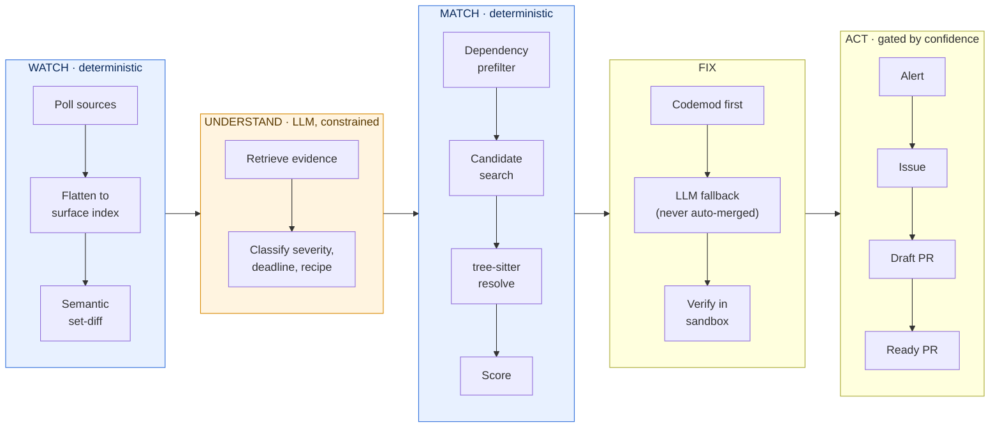

| Stage | Question it answers | Where it lives |
| --- | --- | --- |
| **Watch** | What did the provider publish, and what changed? | `Watch/`, `Services/SourceIngestion.py` |
| **Understand** | How severe is it, is there a deadline, is there a recipe? | `Watch/Classifier.py`, `Watch/Evidence.py`, `Services/ModelClient.py` |
| **Match** | Which lines in *this* repository does it touch? | `Match/` |
| **Fix** | What is the smallest verified patch? | `Fix/` |
| **Act** | What is the strongest thing we are allowed to do? | `Match/Scorer.py` (`decide`), `Services/GithubPublisher.py` |

---

## Architecture

### Runtime components

The ingestion path is a set of small, independent processes that share PostgreSQL as the
system of record and as the work queue. Nothing is held only in memory.

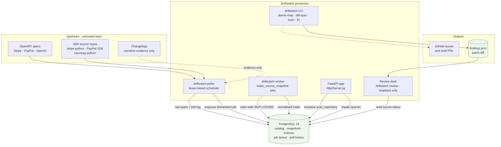

Solid lines are implemented and tested. Dotted lines are narrative-only inputs or wiring that is
not yet automated end to end (see [Project status](#project-status)).

### Layering

The codebase follows ports-and-adapters with strict inward dependencies, so every external
system can be replaced by a deterministic fake in tests.

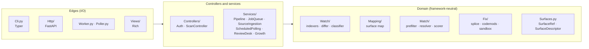

Rules that keep it honest: services never import Typer or Rich; controllers never implement
matching or diffing; the HTTP layer only deserialises, authenticates, calls a controller and
maps typed errors; domain modules know nothing about HTTP or SQL.

---

## Data flow

### 1. Source ingestion: from provider to normalised index

This is the durable path that runs continuously. Raw bytes are persisted **before** any
parsing, so a parser bug can never lose data, and every step is idempotent.

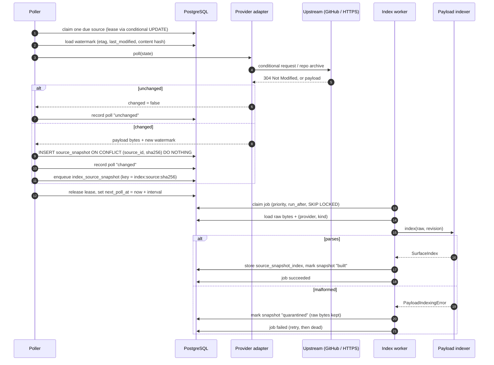

Idempotency is layered: duplicate payloads collapse on `(source_id, content_sha256)`, duplicate
jobs collapse on the `idempotency_key`, and polling leases stop two pollers claiming one source.

### 2. Job lifecycle

A small PostgreSQL-backed queue (`job`, `job_state`, `job_payload`, `job_run`). Workers claim
with `FOR UPDATE SKIP LOCKED`, so any number of them can run without double-processing.

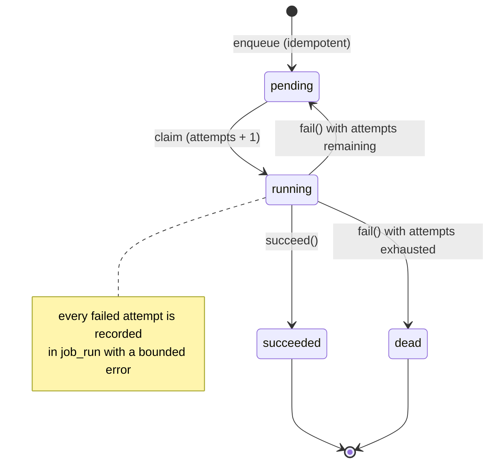

### 3. Snapshot indexing states

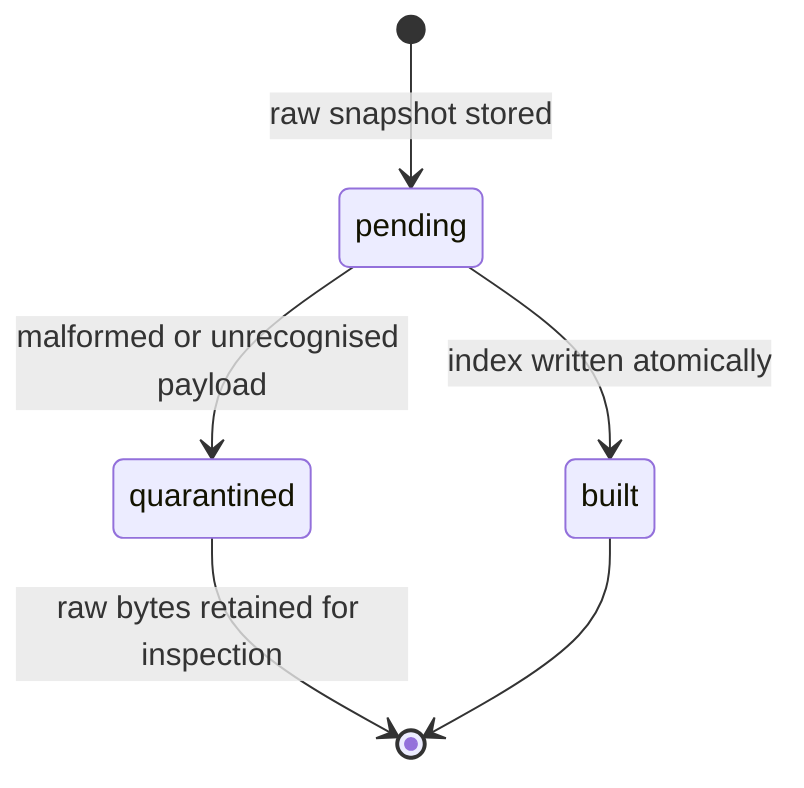

### 4. Matching: a funnel that trades recall for precision, cheapest stage first

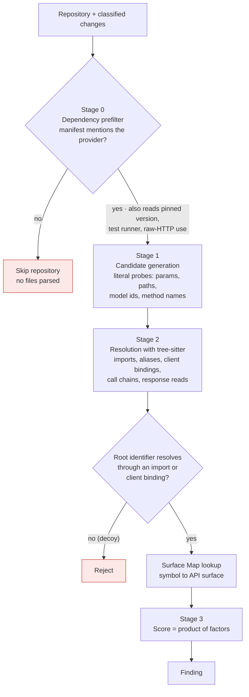

The one-line check that rejects decoys: a call's **root identifier must resolve through an
import or a client binding before the attribute chain is even looked up**.

A worked resolution:

```python
import stripe as pay  # 1. alias table: pay -> stripe

client = pay.StripeClient(api_key)  # 2. client binding: client -> stripe
charge = client.charges.create(amount=1000, source=tok)
#        ^ 3. flatten chain: client.charges.create -> stripe.charges.create
#          4. Surface Map: api:stripe/op:post_v1_charges
#          5. keyword arg `source=` -> .../param:source        (parameter hit)
print(charge.source)  # 6. assignment tracking -> response-field hit
```

Confidence is a product of independent factors, any of which can veto by going to zero:

```text
confidence = surface_map × resolution × match_kind × change_type_prior × version_applicable
```

### 5. Deciding what to do: the trust ladder

`decide()` returns the strongest action a finding has *earned*, and never more than the
repository's configured ceiling.

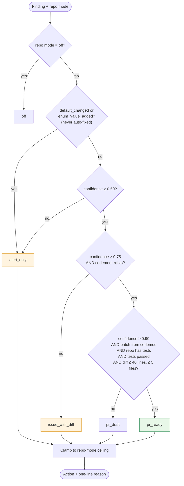

| Action | Requirements |
| --- | --- |
| `pr_ready` | confidence ≥ 0.90 **and** deterministic codemod **and** repo has tests **and** tests pass **and** diff ≤ 40 lines across ≤ 5 files |
| `pr_draft` | confidence ≥ 0.75 and a codemod exists, but a `pr_ready` precondition is missing |
| `issue_with_diff` | confidence ≥ 0.50 |
| `alert_only` | otherwise, and **always** for `default_changed` and `enum_value_added` |

New installations are meant to start at `issue_with_diff`. Write access is *earned* through
measured precision, never assumed.

### 6. Fix and verification

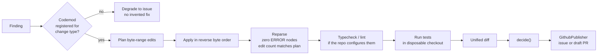

### 7. Core data model

The implemented ingestion and queue schema (migrations `001`–`004`). The full 32-table target
schema is in [`docs/dataModel.sql`](docs/dataModel.sql).

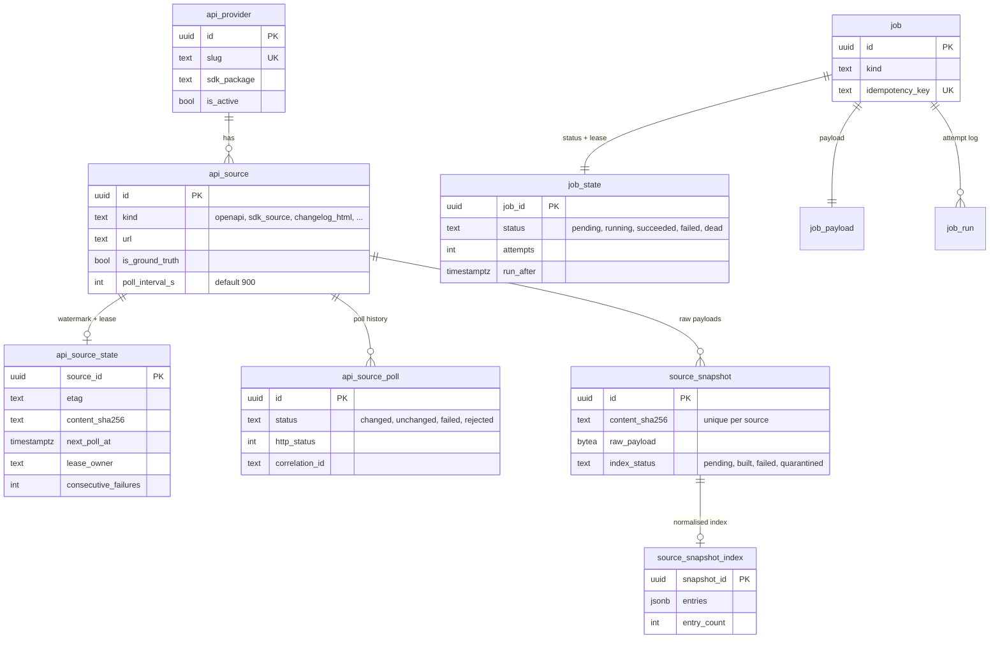

---

## Core concepts

### Surface index

Never text-diff an 8 MB JSON document. OpenAPI, GraphQL SDL and SDK source are all flattened
into the same canonical map, so **one differ, one matcher and one fix engine serve every
provider**.

```text
SurfaceIndex = dict[SurfaceRef, SurfaceDescriptor]

api:stripe/op:post_v1_charges
api:stripe/op:post_v1_charges/param:source
api:stripe/obj:charge/field:payment_method_details
api:stripe/enum:charge.status/value:pending
api:openai/model:gpt-4-vision-preview
```

A `SurfaceDescriptor` is the semantic payload compared across revisions: `kind`, `type_sig`,
`required`, `nullable`, `default` (the silent-change detector), `enum_values`, `deprecated`,
`sunset_on`, a separate `doc_hash` (documentation changed but shape did not) and a
`source_locator` used to cite evidence. `$ref` resolution, `allOf` flattening and sorted enums /
`oneOf` members are what keep cosmetic spec regeneration from producing phantom diffs.

### Surface Map: derived, not curated

The hardest join in the product is *"the spec says `POST /v1/charges` changed"* → *"your code
calls `client.charges.create(...)`"*. Provider SDKs are **generated from the spec**, so the HTTP
path sits in the source beside each method:

```python
class ChargeService(StripeService):
    def create(self, params, options=None):
        return cast(Charge, self._request("post", "/v1/charges", ...))
```

Parsing that with tree-sitter removes the hand-curation bottleneck. All of these resolve to the
same operation:

```text
api:stripe/op:post_v1_charges
    py:stripe.Charge.create            # legacy static resource
    py:stripe.ChargeService.create     # service class
    py:stripe.v1.charges.create        # namespaced client accessor
    py:stripe.charges.create           # top-level client alias
```

### Change taxonomy

Derived mechanically from descriptor transitions. The taxonomy drives fix strategy and gating.

| `change_type` | Severity | Strategy |
| --- | --- | --- |
| `operation_removed` | breaking | alert / issue |
| `operation_moved` | breaking | codemod |
| `param_renamed` | breaking | **codemod, high confidence** |
| `param_added_required` | breaking | codemod inserting a `TODO`, draft PR |
| `param_removed`, `param_type_changed` | breaking | issue (no safe mechanical fix) |
| `response_field_removed` / `_renamed` | breaking | issue / codemod |
| `enum_value_removed` | breaking | codemod when a mapping is known |
| `enum_value_added` | behavioural | info; **never auto-fixed** |
| `default_changed` | **behavioural / silent** | alert and explain; **never auto-fixed** |
| `model_deprecated` | deadline | **codemod, high confidence** |
| `operation_deprecated`, `param_deprecated` | deprecating | codemod if recipe, else alert |
| `operation_added`, `param_added_optional` | additive | suppressed by default |

Additive changes are about 90% of volume. They are suppressed from alerts so the product never
feels like spam.

### Idempotency: the anti-spam invariant

Everything is content-addressed. A finding's fingerprint hashes its change, file, scope,
occurrence and a *normalised snippet*, **not a line number**, so reformatting a file does not
manufacture a duplicate. Re-scanning updates existing artifacts instead of opening new ones.

```text
spec / payload   sha256(raw bytes), unique per source
change           stable hash of the change identity (Delta.fingerprint)
finding          H(change, file, scope, occurrence, surface_ref, snippet_anchor)
GitHub artifact  marker derived from the change fingerprint, looked up before create
```

---

## Provider coverage

| Provider | Ground truth | Indexed today | Surface Map | Notes |
| --- | --- | --- | --- | --- |
| **Stripe** | OpenAPI (`stripe/openapi`) + `stripe-python` | OpenAPI | Derived from SDK source | Reference provider; every spike gate was run on it. |
| **PayPal** | OpenAPI (`paypal-rest-api-specifications`) + `PayPal-Python-Server-SDK` | OpenAPI and SDK source | Derived from `paypalserversdk` controllers | First-class. Orders v2 and Payments v2; has the `paypal-demo` command. |
| **OpenAI** | OpenAPI (`openai-openapi`) | OpenAPI | Not yet | Model shutdowns are the dominant change class here. |
| **Razorpay** | SDK source only (no public OpenAPI exists) | SDK HTTP call literals | Not yet | Exercises the SDK-source adapter path. |

Narrative sources (changelogs, blogs, docs) are **evidence only**. They can support a detected
change but can never create or confirm one on their own.

---

## Project status

Pre-1.0. The risky assumptions were de-risked first (all four spike gates passed against live
Stripe data), then the durable ingestion backbone and the review tooling were built on top.
Production integrations are intentionally deferred behind typed, fake-first interfaces.

| Area | State | Notes |
| --- | --- | --- |
| OpenAPI surface indexer and semantic differ | **Implemented, tested** | 0.17 s for 7.9 MB; zero phantom diffs in the self-diff control |
| Surface Map derivation (Stripe, PayPal) | **Implemented, tested** | 585 Stripe operations, cross-validated against the spec |
| Python matcher and scorer | **Implemented, tested** | Decoy corpus: 0 false positives |
| TypeScript resolver | Implemented, newer | Calls, request keys and raw HTTP; less field-validated than Python |
| Byte-splice codemods | **Implemented, tested** | `rename_keyword_argument`, `rename_dict_key`, `replace_string_literal`, `insert_required_keyword_argument` |
| Trust-ladder gating | **Implemented, exhaustively tested** | Every threshold and missing precondition |
| Durable ingestion (poller, worker, queue, PostgreSQL) | **Implemented, integration-tested in CI** | Leases, idempotency, quarantine |
| GitHub repository source adapters | **Implemented** | Archive download, only indexable files extracted |
| Review desk (local web UI) | **Implemented** | Label true/false/unsure to measure precision |
| FastAPI app (`/v1/scans`, `/v1/dashboard/impact`, health) | **Implemented** | Auth0 RS256 JWT validation, tenant-scoped |
| GitHub issue / draft-PR publisher | Implemented | Idempotent, strict input validation; token-based |
| OpenAI-compatible model client | Stubbed, fake-first | Bounded and schema-validated; not yet wired into the CLI pipeline |
| Local sandbox runner | Development boundary only | Not a production security boundary |
| `scan_repository` job consumer | **Not yet built** | The API enqueues the job; no worker consumes it yet |
| Alert delivery, dashboard UI, billing | Planned | Contracts defined in `docs/productionContracts.md` |
| GitHub App installation-token flow | Planned | |
| Container / gVisor sandbox | Planned | |

See [`docs/Scope Boundries.md`](docs/Scope%20Boundries.md) for the authoritative list of
intentional limitations.

---

## Quick start

### Prerequisites

| Tool | Version | Needed for |
| --- | --- | --- |
| Python | 3.12+ | everything |
| [uv](https://docs.astral.sh/uv/) | recent | dependency management and running commands |
| bash 4+, `curl`, `tar` | | `scripts/fetchFixtures.sh` (uses associative arrays) |
| PostgreSQL | 16 | ingestion, workers, the API, integration tests |
| Docker | optional | the easiest way to get PostgreSQL 16 |

### 1. Install and test

```bash
git clone https://github.com/Bilalk0804/Self-Maintaining-APIs.git
cd Self-Maintaining-APIs
uv sync
./scripts/fetchFixtures.sh      # pinned Stripe + PayPal specs and SDKs into .cache/ (idempotent)
uv run pytest tests/unit        # fast tests, no database required
```

### 2. Run the detection pipeline (no database needed)

```bash
# 1. Derive the endpoint -> code-symbol map from SDK source, cross-checked against the spec
uv run driftwatch derive-map --sdk-root .cache/stripe-python \
                             --out .cache/surface_map.json --spec .cache/spec_T2.json

# 2. Diff two real revisions of Stripe's OpenAPI document into classified changes
uv run driftwatch diff-spec --before .cache/spec_T0.json --after .cache/spec_T2.json \
                            --out .cache/deltas.json

# 3. Find the code those changes affect
uv run driftwatch scan --repo tests/fixtures/sampleRepo --changes .cache/deltas.json \
                       --surface-map .cache/surface_map.json --out .cache/findings.json

# 4. Generate a minimal patch
uv run driftwatch fix --repo tests/fixtures/sampleRepo \
                      --findings .cache/findings.json --out .cache/patch.diff
```

PayPal uses the same flow, or runs end-to-end in one command with no database required:

```bash
# One-command PayPal AI Hackathon showcase:
# 1. Derives 41 operations (82 bindings) from APIMATIC-generated PayPal-Python-Server-SDK
# 2. Diffs PayPal Orders v2 OpenAPI revisions
# 3. Classifies every operation change through the evidence-grounded AI boundary
# 4. Scans tests/fixtures/paypalRepo and writes findings to .cache/reviews/paypal-findings.json
# 5. Executes or prepares the PayPal Sandbox B2B workspace checkout ($49.00 USD)
uv run driftwatch paypal-showcase

# Optional: set live OpenAI and PayPal Sandbox credentials from developer.paypal.com
export OPENAI_API_KEY="sk-..."
export PAYPAL_SANDBOX_CLIENT_ID="your-real-sandbox-client-id"
export PAYPAL_SANDBOX_CLIENT_SECRET="your-real-sandbox-secret"
uv run driftwatch paypal-checkout
uv run driftwatch paypal-checkout --capture ORDER_ID
```

### 3. Review findings in the browser

```bash
uv run driftwatch review --root .cache/reviews     # http://127.0.0.1:8765
```

The directory holds one findings JSON per repository (the output of `scan`). Select a row and
press **1** (true hit), **2** (false hit), **3** (unsure) or **0** (clear); verdicts are saved to
`verdicts.json` in that directory. The desk binds to loopback only and refuses any other host.

<!--
  SCREENSHOT SLOT 3 — Review desk, detail pane.
  Content: one finding selected, showing the surface, confidence, matched snippet and the
  True / False / Unsure buttons, with the summary line showing a few labels already applied.
  Save as docs/assets/review-desk-detail.png, then uncomment:

  <p align="center"></p>
-->

### 4. Run the durable backend

Start PostgreSQL and apply the migrations in order:

```bash
docker run -d --name driftwatch-pg -p 5432:5432 \
  -e POSTGRES_USER=driftwatch -e POSTGRES_PASSWORD=driftwatch -e POSTGRES_DB=driftwatch_dev \
  postgres:16

export DRIFTWATCH_DATABASE_URL="host=127.0.0.1 dbname=driftwatch_dev user=driftwatch password=driftwatch"
for f in 001JobQueue 002NormalizeJobQueue 003ProviderCatalog 003ProviderPayloads 004SourceIndex; do
  psql "$DRIFTWATCH_DATABASE_URL" --set ON_ERROR_STOP=1 --file "migrations/$f.sql"
done
```

`003ProviderCatalog.sql` also seeds the four providers and their sources.

Then run the processes (each in its own terminal, or under a supervisor):

```bash
uv run driftwatch-poller      # claims due sources, fetches, snapshots, enqueues index jobs
uv run driftwatch-worker      # claims index jobs, builds normalised indexes
uv run driftwatch review      # review desk; with the database URL set it also shows source search status
```

Or run a one-shot, repeatable demo against real PayPal repositories:

```bash
uv run driftwatch paypal-demo                    # poll, snapshot, index, report counts
uv run driftwatch paypal-demo --force-refresh    # clear watermarks, fetch fresh archives
```

<!--
  SCREENSHOT SLOT 4 — `driftwatch paypal-demo` output.
  Content: the Rich table "PayPal pipeline demo" with source, status, indexed operations and
  detected changes columns.
  Save as docs/assets/paypal-demo.png, then uncomment:

  <p align="center"></p>
-->

### 5. Run the HTTP API

```bash
export DRIFTWATCH_AUTH0_ISSUER="https://YOUR_TENANT.auth0.com/"
export DRIFTWATCH_AUTH0_AUDIENCE="https://api.driftwatch.example"
export DRIFTWATCH_WORKSPACE_ROOT="/var/lib/driftwatch/workspaces"
export DRIFTWATCH_ENABLE_API_DOCS=true           # off by default; enables /docs and /api-explorer

uv run uvicorn Driftwatch.Http.Server:app --host 127.0.0.1 --port 8000
```

Missing security configuration fails startup. There is no fake-auth fallback.

<!--
  SCREENSHOT SLOT 5 — interactive API explorer (Swagger UI at /docs).
  Content: the expanded POST /v1/scans and GET /v1/dashboard/impact operations.
  Save as docs/assets/api-explorer.png, then uncomment:

  <p align="center"></p>
-->

---

## CLI reference

All commands run as `uv run driftwatch <command>`.

| Command | Purpose | Key options |
| --- | --- | --- |
| `derive-map` | Derive the Surface Map from generated SDK source | `--sdk-root` (required), `--provider stripe\|paypal`, `--spec` (cross-validate), `--out` |
| `diff-spec` | Diff two OpenAPI documents into classified changes | `--before`, `--after` (required), `--provider`, `--include-additive`, `--out` |
| `scan` | Find code in a repository affected by a set of changes | `--repo`, `--changes`, `--surface-map` (required), `--mode`, `--out` |
| `fix` | Generate a byte-splice patch for every auto-fixable finding | `--repo`, `--findings` (required), `--replacement old=new` (repeatable), `--out` |
| `review` | Serve the local review desk | `--root`, `--host` (loopback only), `--port`, `--database-url` |
| `paypal-demo` | Poll, snapshot and index PayPal sources against PostgreSQL | `--database-url`, `--force-refresh` |

Standalone entry points: `driftwatch-poller` and `driftwatch-worker` (configured by environment).

`--mode` is the repository's action ceiling: `off`, `alert_only`, `issue_with_diff`,
`pr_draft` or `pr_ready`.

---

## HTTP API

| Method and path | Auth | Description |
| --- | --- | --- |
| `POST /v1/scans` | Bearer JWT | Validate and enqueue a repository scan. Returns `202` with `job_id`, `status`, `idempotency_key`. |
| `GET /v1/dashboard/impact` | Bearer JWT | Account-scoped upcoming impact: change, severity, deadline, repos affected, best confidence. |
| `GET /healthz` | none | Process liveness. No dependency details. |
| `GET /readyz` | none | Readiness; runs a bounded `SELECT 1`. `503` when the database is unreachable. |
| `GET /docs`, `/redoc`, `/openapi.json`, `/api-explorer` | none | Only when `DRIFTWATCH_ENABLE_API_DOCS=true`. |

```bash
curl -sS -X POST http://127.0.0.1:8000/v1/scans \
  -H "Authorization: Bearer $TOKEN" -H "Content-Type: application/json" \
  -d '{"repository_id": "acme/checkout", "provider": "stripe", "commit_sha": "9fceb02"}'
# 202 {"job_id": "…", "status": "…", "idempotency_key": "scan:…"}
```

Security properties of the HTTP layer:

- RS256 only, with exact issuer, exact audience, expiry, issued-at, subject and JWKS checks.
- The **account is derived from verified claims**. Clients can never supply an account ID or a
  filesystem path; the workspace is resolved server-side from a trusted root.
- Unknown request fields are rejected (`extra="forbid"`).
- `401` for authentication failures and `403` for authorization failures, without disclosing
  whether a tenant or repository exists.

---

## Configuration

All runtime configuration is environment-driven and validated at startup. Missing security
settings fail closed.

| Variable | Used by | Required | Default | Purpose |
| --- | --- | --- | --- | --- |
| `DRIFTWATCH_DATABASE_URL` | poller, worker, API, `review`, `paypal-demo` | yes (except pure CLI pipeline) | | PostgreSQL connection string |
| `DRIFTWATCH_TEST_DATABASE_URL` | integration tests, `paypal-demo` fallback | for integration tests | | Throw-away test database |
| `DRIFTWATCH_AUTH0_ISSUER` | API | yes | | Exact expected JWT issuer |
| `DRIFTWATCH_AUTH0_AUDIENCE` | API | yes | | Exact expected JWT audience |
| `DRIFTWATCH_WORKSPACE_ROOT` | API | yes | | Trusted root that repository workspaces resolve under |
| `DRIFTWATCH_ENABLE_API_DOCS` | API | no | `false` | `true` or `false`; exposes Swagger UI and the OpenAPI document |
| `DRIFTWATCH_WORKER_ID` | worker | no | `indexer-<host>-<pid>` | Identity recorded on job leases |
| `DRIFTWATCH_WORKER_IDLE_DELAY` | worker | no | `1.0` s | Sleep when the queue is empty |
| `DRIFTWATCH_WORKER_ERROR_DELAY` | worker | no | `5.0` s | Back-off after an unexpected error |
| `DRIFTWATCH_POLLER_ID` | poller | no | `poller-<host>-<pid>` | Identity recorded on source leases |
| `DRIFTWATCH_POLLER_LEASE_SECONDS` | poller | no | `300` | Source lease duration |
| `DRIFTWATCH_POLLER_IDLE_DELAY` | poller | no | `1.0` s | Sleep when no source is due |
| `DRIFTWATCH_POLLER_ERROR_DELAY` | poller | no | `5.0` s | Back-off after an unexpected error |

Sources are polled every `poll_interval_s` seconds (default **900**, i.e. 15 minutes) as stored
on each `api_source` row. Both processes shut down cleanly on `SIGINT`/`SIGTERM`.

---

## Project layout

```text
src/Driftwatch/
├── Surfaces.py             SurfaceRef / SurfaceDescriptor / SurfaceIndex, the shared vocabulary
├── Providers.py            Static provider metadata and source locations
├── Tsutil.py               tree-sitter helpers
├── Cli.py                  Typer controllers (derive-map, diff-spec, scan, fix, review, paypal-demo)
├── Poller.py · Worker.py   Long-running processes for polling and indexing
├── Watch/                  OpenapiIndexer · Differ · Classifier · Evidence
│                           PayloadIndexers · ProviderAdapters · SourceAdapters · GithubSourceAdapters
├── Mapping/                SdkPython · SdkPaypal · Model: derive endpoint <-> symbol bindings
├── Match/                  Prefilter · Candidates · Resolver · TypescriptResolver · Scorer · Engine
├── Fix/                    Splice (byte-range edits) · Codemods · Sandbox
├── Services/               Pipeline · JobQueue · SourceIngestion · ScheduledPolling · WorkerRuntime
│                           AutonomousWatch · ReviewDesk · GithubPublisher · ModelClient
│                           PayPalDemo · Growth (impact queries, RSS, alerts, calibration)
├── Controllers/            Auth (Auth0 JWT) · ScanController
├── Http/                   Application · Server · ReviewApp · review/ (static review-desk UI)
└── Views/                  Console (Rich presentation)

migrations/                 001–004 SQL migrations for the queue, catalog, snapshots and indexes
scripts/fetchFixtures.sh    Pinned upstream inputs for the spike and the gates
tests/                      unit/ · integration/ · fixtures/sampleRepo (five usages, five decoys)
docs/                       Design, contracts, data model, spike results
```

---

## Design decisions

- **Detection is deterministic; the model only narrates and proposes.** Every change record
  must cite evidence or it is quarantined, never shipped.
- **The Surface Map is derived, not curated.** Generated SDKs carry the HTTP path beside each
  method; parsing it makes broad API coverage affordable and lets derived entries cross-validate
  hand-curated ones.
- **Surface index, not document diff.** OpenAPI, GraphQL SDL and SDK source all reduce to
  `{SurfaceRef: SurfaceDescriptor}`. Adding a provider means writing one indexer, not a pipeline.
- **Codemods splice bytes; they never re-print a syntax tree.** An AST round-trip reformats the
  file and buries a two-line change in hundreds, which is how automated PRs get closed unread.
- **Silent behavioural changes are first-class, and never auto-fixed.** A changed default is the
  most valuable thing to detect and the least safe thing to patch automatically.
- **A known recall gap beats a silent false positive.** Resolution is deliberately conservative.
- **Trust is earned.** New installations open issues, not PRs; promotion requires measured
  precision from the review desk.
- **Raw bytes first, parse second.** Payloads are persisted before parsing, and malformed ones
  are quarantined rather than dropped.
- **Ground truth versus narrative.** Only `is_ground_truth` sources can produce authoritative
  surface data.
- **Fake-first integrations.** Every production adapter has a typed protocol and a deterministic
  fake, so the default test path needs no cloud project, paid API or credential.

---

## Security model

Driftwatch reads attacker-influenceable content (scraped pages, public repositories) and
proposes code. The containment story is that the components that read hostile input cannot act.

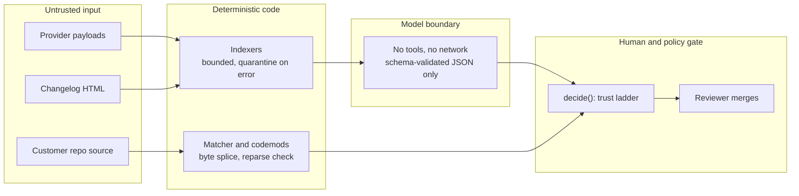

| Threat | Mitigation in this codebase |
| --- | --- |
| Hostile repository test suite | `SandboxRunner` runs in a disposable copy with a scrubbed environment, proxies pointed at a dead port, symlinks dropped, a wall-clock timeout and a new process session. **This is a development boundary only**; production isolation (container or gVisor, `--network=none`, resource limits) is specified but not built. |
| Prompt injection | Fetched text is treated as data. The model client is bounded by input size, timeout and retries, returns JSON only, and its output is validated and citation-checked before use. |
| Hallucinated change records | Detection is computed, never generated. Citations must resolve against retrieved evidence. |
| Token and secret exposure | Secrets come from the environment only. HTTP clients disable `trust_env` and redirects. The sandbox never inherits secrets. |
| Path traversal in publishing and fixing | `GithubPublisher` validates repo slug, branch and file path (no `..`, no absolute paths, no `.git`/`.github`). `fix` skips symlinks and paths outside the repository root. |
| Cross-tenant access | Account identity comes only from verified JWT claims; repositories resolve by authenticated ownership; workspaces derive from a trusted root. |
| Review-desk exposure | Binds to loopback only and rejects any other host. Verdict writes are atomic. |
| Duplicate or spammy artifacts | Content-addressed idempotency at the payload, job, finding and GitHub-artifact layers. |

---

## Testing and quality

```bash
uv run pytest tests/unit                        # fast, hermetic
DRIFTWATCH_TEST_DATABASE_URL="host=127.0.0.1 dbname=driftwatch_ci user=driftwatch password=driftwatch" \
  uv run pytest tests/integration               # needs PostgreSQL with the migrations applied
uv run pytest                                   # everything
uv run ruff check src/Driftwatch tests          # lint
uv build                                        # wheel + sdist
```

- **182 tests**: 180 run without a database; 2 PostgreSQL integration tests cover queue
  claim/succeed and poll → snapshot → enqueue → index.
- The spike gates are encoded as regression tests, and the gating table is tested exhaustively
  because it is the component that protects user trust.
- **CI** ([`.github/workflows/ci.yml`](.github/workflows/ci.yml)) provisions PostgreSQL 16,
  applies every migration in order, runs `ruff`, the full test suite, verifies the schema
  and seed data, then builds the package.
- Style: four-space indentation, 100-character lines, Ruff rules `E`, `F`, `I`, `UP`, `B`.

---

## Measured results

From the de-risking spike, run against live Stripe data (full detail in
[`docs/gateResults.md`](docs/gateResults.md)).

| Gate | Claim | Result |
| --- | --- | --- |
| **A1** Surface Map is derivable | ≥ 300 operations derived | **585 operations, 3,888 bindings in 1.5 s**; 94.5% of derived operations present in the spec; 0 unexplained mismatches |
| **A2** Semantic diff is fast and quiet | < 10 s, zero phantom changes | **0.17 s** to index 7.9 MB (12,924 surfaces); self-diff = 0 deltas; adjacent revisions = 1 real change, 0 phantom |
| **A3** Matcher rejects look-alikes | all true positives, both decoys rejected | All six usage shapes found; **all five decoys rejected; 0 false positives** |
| **A4** Patches are reviewable | diff touches only intended lines | **+1 / −1 lines**, byte-identical elsewhere, passes `git apply --check` |

Defects the gates caught (and fixed) are the best evidence the validation was real: bare class
names cross-binding three different `SessionService` classes, `class_url` overrides producing
`/v1/balance_settingss`, v2 resources nested under `/v1`, kwargs filtering that discarded the
very findings that matter, and one operation-level change fanning out into nine findings.

The single change detected across four days is itself the argument for the product: an enum
gained values (`final_payment_failure`, `first_payment_failure`). Nothing returns a 4xx and no
changelog entry is required. Only a spec diff finds it.

---

## Known limitations

These are deliberate and tracked, not oversights.

- **Matcher precision is measured on a fixture, not yet on the wild.** A hand-audit of real
  public repositories with the review desk is the honest next test.
- **The Surface Map is derived from SDK `master`**, not from the version each repository pins.
  The scorer compensates; production must derive per pinned version.
- **Response-field resolution is intra-procedural and assignment-only.** Fields reached through a
  helper's return value, a dict round-trip or a comprehension are missed.
- **No `scan_repository` consumer yet.** `POST /v1/scans` validates and enqueues; nothing
  processes the job.
- **The LLM understanding layer is not wired into the CLI pipeline.** The client and the
  grounding validator exist and are tested against a scripted fake.
- **Stripe `/v2/` operations** derive correctly but have no spec to diff against.
- **Dependency prefilter** reads `requirements*.txt`, `pyproject.toml`, `Pipfile` and
  `package.json`. Lockfile parsing (`poetry.lock`, `package-lock.json`, `yarn.lock`,
  `pnpm-lock.yaml`) is designed but not implemented.
- **Languages:** Python is the primary target; TypeScript is newer.
- **No LICENSE file has been added yet.**

---

## Roadmap

- [x] Spike: derive the map, diff specs, match with decoys, splice patches
- [x] Durable ingestion: poller, queue, snapshots, quarantine
- [x] PayPal as a first-class provider
- [x] Review desk and measured precision labels
- [ ] `scan_repository` worker: clone, scan, persist findings, publish
- [ ] Wire the constrained LLM understanding stage into the pipeline
- [ ] Audit ~20 real repositories; stop and fix if precision < ~0.8
- [ ] GitHub App with per-job installation tokens and webhooks (PR outcome as feedback signal)
- [ ] Confidence recalibration from merged-versus-closed outcomes
- [ ] Production sandbox (container or gVisor, no network during tests)
- [ ] Alert delivery (Slack, email, signed webhooks) and the dashboard
- [ ] Surface Map for OpenAI and Razorpay; Twilio; GraphQL SDL indexer (Shopify)
- [ ] Lockfile-aware version applicability

---

## Documentation index

| Document | What it covers |
| --- | --- |
| [`docs/systemDesign.md`](docs/systemDesign.md) | Architecture, change taxonomy, trust ladder, security, cost, prior art, risks |
| [`docs/pipelineContracts.md`](docs/pipelineContracts.md) | Stage interfaces and trust boundaries |
| [`docs/dataContracts.md`](docs/dataContracts.md) | Records and payloads exchanged across the data flow |
| [`docs/apiContract.md`](docs/apiContract.md) | Compatibility index for HTTP and LLM contracts |
| [`docs/dataModel.sql`](docs/dataModel.sql) | Full 32-table schema, verified on PostgreSQL 16 |
| [`docs/productionContracts.md`](docs/productionContracts.md) | Fillable contracts for deferred production integrations |
| [`docs/Scope Boundries.md`](docs/Scope%20Boundries.md) | Intentional limitations; what must not be read as production behaviour |
| [`docs/prototypePlan.md`](docs/prototypePlan.md) | The spike, then the 6–8 week MVP plan |
| [`docs/gateResults.md`](docs/gateResults.md) | Spike measurements and what they do and do not prove |

---

## Contributing

1. `uv sync` and `./scripts/fetchFixtures.sh`.
2. Keep dependencies pointing inward: domain → services → controllers → edges. Services must not
   import Typer or Rich; controllers must not implement matching or diffing.
3. Every external boundary gets a typed protocol **and** a deterministic fake.
4. Add a test for every behaviour change; for matcher changes, add a **decoy** as well as a hit.
5. Before pushing: `uv run ruff check src/Driftwatch tests && uv run pytest`.

---

<div align="center">

Built by [Bilal](https://github.com/Bilalk0804) · Driftwatch is a working name.

</div>
